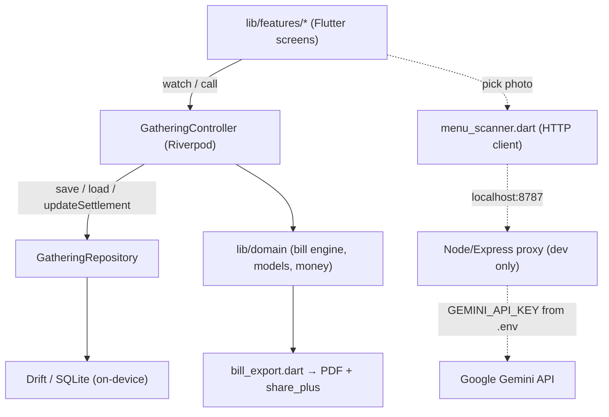

# Ordo — Project Handover

> Read this document before making any changes. It is written so a developer or
> AI coding agent can understand and run Ordo without the original design
> conversations. If anything here conflicts with the code, trust the code and
> update this file.

---

## A. Project overview

**Ordo** is an offline-first, pass-and-play dining companion for Android. One
phone is passed around a table: the host sets up a gathering, each person adds
their order, a waiter mode tracks what has been served, and at the end Ordo
produces an itemised bill that can be split, settled and shared.

- **What it does today:** create a gathering, build or scan a menu, collect
  per-participant orders, track serving, compute a configurable bill, split it
  two ways, track who has paid, and export the bill as text or PDF through the
  native Android share sheet. Everything works with no network and no account.
- **Product vision:** a seamless group-dining experience with total privacy and
  immediate usability — no sign-in, no backend, all data stored locally for the
  current session. Later stages add an optional shared/multi-device mode.
- **Current development stage:** Stages 1–6 complete. Stage 6 (billing,
  settlement, export) is implemented and committed but has **not** yet had a
  physical-device verification pass for PDF export and the Android share sheet.

---

## B. Technology stack

| Layer | Choice |
| --- | --- |
| App framework | Flutter (Dart, SDK `^3.12.2`) |
| State management | Riverpod (`flutter_riverpod`) |
| Navigation | `go_router` |
| Local persistence | Drift over SQLite (`drift`, `drift_flutter`) |
| Menu scanner proxy | Node.js + Express (`tools/menu-scanner-proxy`) |
| Menu extraction model | Google Gemini (via the local proxy only) |
| PDF generation | `pdf` + `printing` |
| Sharing | `share_plus` (native Android share sheet), `path_provider` |
| Image selection | `image_picker` |
| Fonts | Inter + Playfair Display, bundled as assets (OFL), never downloaded |

---

## C. Architecture

Ordo is **offline-first**. The Flutter app is self-contained: all gathering,
menu, order and bill data lives in a local SQLite database managed by Drift. No
feature except the optional menu scanner touches the network, and the scanner
degrades gracefully when its local proxy is not running.

Layering (strict, inner layers never import outer ones):

- **`lib/domain/`** — pure Dart models and logic: `Gathering`, `Menu`,
  `Participant`, `OrderLine`, the `GatheringBill`/`BillConfig` billing engine,
  `money.dart` (integer-paise helpers), and `bill_formatter.dart` (text export).
  No Flutter, no I/O — fully unit-testable.
- **`lib/application/`** — `GatheringController` (a Riverpod `Notifier`) owns the
  active gathering and enforces the lifecycle
  (`menuDraft → ordering → serving → completed`). Every change is saved through
  the repository as it happens, via a serialized save queue.
- **`lib/data/`** — the `GatheringRepository` interface and its two
  implementations: `LocalGatheringRepository` (Drift) and
  `InMemoryGatheringRepository` (tests/default). Also `menu_scanner.dart`, the
  HTTP client for the local Gemini proxy.
- **`lib/features/`** — screens, grouped by flow (`session_flow`, `history`,
  `menu_scanner`). UI reads domain state through Riverpod and calls controller
  methods; it never talks to the database directly.



Solid arrows are always-available offline paths. Dotted arrows are the
network-dependent scanner path, used only when the host chooses to scan a menu
and the local proxy is running.

---

## D. Completed stages

| Stage | Scope | Notes |
| --- | --- | --- |
| 1 | Domain and state foundation | Core models and the gathering lifecycle. |
| 2 | Navigation | `go_router` with lifecycle guards. |
| 3 | Local persistence | Drift/SQLite, session history. |
| 4 | UI polish and device reliability | Real-device reliability work. |
| 5 | Gemini menu scanner (proof of concept) | Commit **`861586d`**. |
| 6 | Bill summary, split modes, settlement, export | Commit **`5d955b5`**. |

**Stage 5 and Stage 6 are separate commits** (`861586d` and `5d955b5`
respectively); do not squash them together. Documentation lives in its own
commit after Stage 6.

Verification results captured at handover:

- `dart format --output=none --set-exit-if-changed .` — clean.
- `flutter analyze` — no issues.
- `flutter test` — 194/194 passing.
- Node proxy `npm test` — 20/20 passing.
- Real-device PDF export and Android share sheet — **pending**.

---

## E. Menu scanner setup

The scanner is a **development-only proof of concept**. It is reachable from the
gathering's menu-selection screen ("Scan Menu"); there is no scanner entry on
the home screen.

Flow:

1. **Flutter app** — the user picks a menu photograph with `image_picker`.
2. **Node proxy** — the app POSTs the image to `http://127.0.0.1:8787`
   (`lib/data/menu_scanner.dart`, `defaultBaseUrl`). The proxy is a small
   Express server in `tools/menu-scanner-proxy`.
3. **Gemini** — the proxy calls the Google Gemini API using the key from its
   local `.env`, asking for a structured menu (categories, dishes, variants,
   prices, vegetarian status, confidence flags).
4. **Reviewable menu** — the returned JSON is parsed into `ScannedMenu`
   (`lib/domain/scanned_menu.dart`) and shown on a review screen where the host
   edits categories, dishes, prices and variants, and the app validates them.
5. **Confirm & import** — on confirm, the reviewed menu becomes the gathering's
   `Menu` and the gathering starts, exactly as a manually built menu would.

Key facts:

- **The Gemini API key belongs only in `tools/menu-scanner-proxy/.env`.** It is
  never in the Flutter app, never committed, and `.env` is gitignored. Copy
  `.env.example` to `.env` and fill in your own key.
- **Run the proxy for development:**
  ```bash
  cd tools/menu-scanner-proxy
  npm install
  cp .env.example .env     # then edit .env and set GEMINI_API_KEY
  npm start                # serves on 127.0.0.1:8787
  ```
- **USB device setup:** the proxy listens on the laptop's loopback, so a
  physically connected Android device reaches it through an adb reverse tunnel:
  ```bash
  adb reverse tcp:8787 tcp:8787
  ```
  Run this each time the device is reconnected.
- **Not deployed:** there is no public scanner backend. The scanner works only
  while the local proxy runs and the tunnel is up. Deploying it securely (e.g.
  Google Cloud Run) is future work.

---

## F. Billing implementation

The billing engine is pure Dart in `lib/domain/bill.dart`
(`GatheringBill`, `BillConfig`, `ParticipantShare`) and is computed entirely
offline from each gathering's snapshotted order lines.

- **Pay as you eat** — each participant pays for the items they ordered. Shared
  charges (CGST, SGST, service) and any discount are allocated **in proportion
  to each participant's item subtotal**.
- **Split equally** — the final bill is divided equally across participants.
  **Every participant in the gathering is included by default, even those who
  ordered nothing.** The host can explicitly exclude a participant
  (`BillConfig.excludedParticipantIds`); excluded participants leave the
  denominator.
- **GST** — CGST and SGST rates are configurable (basis points). The previous
  placeholder of 2.5% + 2.5% is only the default, not a fixed assumption.
- **Tax-inclusive vs exclusive** — when prices already include tax, the tax is
  carved back out of the subtotal rather than added on top; when exclusive, it
  is added on top. Service charge is always added on top in both modes.
- **Service charge and discount** — configurable service-charge rate and a flat
  discount off the subtotal. A discount larger than the subtotal floors the bill
  at zero. Negative rates/discount are rejected by `BillConfig.validate()`.
- **Integer paise and rounding** — all money is integer paise. Proportional
  allocation uses the **largest-remainder method** so the per-participant totals
  always sum **exactly** to the grand total, with no lost or invented paisa.
- **Settlement** — paid/pending is tracked per participant and persists. It can
  be toggled after a gathering is completed (see § G).
- **Export** — a plain-text bill (`bill_formatter.dart`) and a PDF
  (`bill_export.dart`, which embeds the bundled Inter font so the ₹ glyph
  renders offline). Both are shared through the **native Android share sheet**
  via `share_plus`.

Tests: `test/domain/bill_test.dart`, `bill_formatter_test.dart`, and
`test/features/bill_export_test.dart`.

---

## G. Database

Local Drift/SQLite database (`lib/data/local/app_database.dart`), **schema
version 3**.

Tables:

| Table | Purpose |
| --- | --- |
| `Gatherings` | One row per gathering: name, restaurant, host, created-at (UTC), status, and (Stage 6) nullable `bill_config_json` and `settlements_json`. |
| `MenuCategories` | Menu categories, keyed per gathering. |
| `MenuItems` | Menu items with price in paise, keyed per gathering. |
| `Participants` | Participants in a gathering. |
| `OrderLines` | One participant's order of one item: name and unit price are **snapshotted** at order time (`menuItemId` is deliberately not a foreign key), plus quantity and served quantity. |

Migrations are `stepByStep`; every schema bump exports a snapshot under
`drift_schemas/ordo/` and regenerates the verifier helpers under
`test/drift/ordo/generated/`. The v2→v3 step only adds the two nullable bill
columns, so existing gatherings migrate untouched and default to the prior
2.5% + 2.5% GST and empty settlement.

**Completed-gathering read-only behaviour:** `save()` and `delete()` throw
`ReadOnlyGatheringException` for a gathering whose status is `completed`. Order
and menu data of a finished gathering can never be edited.

**Settlement without arbitrary edits:** settlement is the one thing that changes
after completion. It goes through a narrowly scoped repository method,
`updateSettlement(gatheringId, participantId, paid)`, which writes **only** the
`settlements_json` column and touches nothing else. This preserves the
read-only guarantee for orders and menu while still allowing paid/pending
tracking.

---

## H. Setup on a new Windows laptop

Copy-paste commands. Replace nothing with a real key or password.

```powershell
# 1. Install Git (https://git-scm.com/download/win), or:
winget install --id Git.Git -e

# 2. Install Flutter: download the stable SDK zip from
#    https://docs.flutter.dev/get-started/install/windows, extract to
#    C:\src\flutter, and add C:\src\flutter\bin to PATH. Then verify:
flutter --version

# 3. Install Android Studio (https://developer.android.com/studio), then in it:
#    SDK Manager -> install Android SDK, Platform-Tools, and a build-tools set.
#    Accept licenses:
flutter doctor --android-licenses

# 4. Android device debugging: on the phone enable Developer Options and USB
#    debugging, connect over USB, then confirm it is visible:
adb devices

# 5. Install Node.js LTS (https://nodejs.org), or:
winget install --id OpenJS.NodeJS.LTS -e

# 6. Clone the repository:
git clone https://github.com/saintvj/Ordo_tech.git
cd Ordo_tech

# 7. Check the toolchain:
flutter doctor

# 8. Install Flutter dependencies:
flutter pub get

# 9. Install Node proxy dependencies:
cd tools\menu-scanner-proxy
npm install

# 10. Create a local .env from the template, then edit it and set GEMINI_API_KEY:
copy .env.example .env

# 11. Start the local proxy (serves on 127.0.0.1:8787):
npm start

# 12. In a second terminal, with the device connected, open the reverse tunnel:
adb reverse tcp:8787 tcp:8787

# 13. Launch Ordo on the device (from the repo root):
cd ..\..
flutter run

# 14. Run the tests and analyzer:
flutter analyze
flutter test
cd tools\menu-scanner-proxy
npm test
```

Steps 10–12 are only needed to use the menu scanner; the rest of the app runs
fully offline without them.

---

## I. Current limitations and pending work

- The scanner proxy is **local-only**; the Gemini backend is **not deployed**.
- PDF export and the native Android share sheet still need a **physical-device
  verification pass**.
- **Supabase is not integrated.** There is no production backend.
- **Shared Gathering and multi-device synchronization are not implemented.**
- **Authentication and invitations are not implemented.**
- **WhatsApp API integration is not implemented.**
- **Play Store release is not complete.**

---

## J. Next development roadmap

1. Move the repository to the personal laptop and verify the dev environment
   (`flutter doctor`, a clean build).
2. Run all existing tests on the personal laptop (`flutter test`, `npm test`).
3. Test the completed billing, PDF export and Android share sheet on a physical
   device.
4. Deploy the Gemini scanner backend securely — Google Cloud Run initially — and
   point the app at it instead of the local proxy.
5. Create a separate Supabase project for Ordo.
6. Design and implement Supabase authentication and Shared Gathering.
7. Implement multi-device synchronization with concurrency-safe updates.
8. Complete production-readiness and Android release work.

---

## K. Instructions for AI coding agents

- **Read this handover document before making changes.**
- **Inspect `git status` before editing**, and understand what is already in the
  working tree.
- **Never commit secrets** — no `.env`, API keys, Supabase keys, tokens or
  credentials, and never `node_modules/` or build outputs. The Gemini key lives
  only in `tools/menu-scanner-proxy/.env`.
- **Preserve offline-first functionality.** No feature except the optional menu
  scanner may require the network.
- **Preserve completed-gathering read-only guarantees.** Do not allow edits to a
  completed gathering's order or menu data; settlement changes go only through
  `updateSettlement`.
- **Use integer paise for all monetary calculations.** Never use floating point
  for money. Reuse the helpers in `lib/domain/money.dart` and the engine in
  `lib/domain/bill.dart` rather than duplicating calculation logic.
- **Run the Flutter analyzer and tests after changes** (`flutter analyze`,
  `flutter test`), and `npm test` in the proxy if you touch it.
- **Do not introduce Supabase or cloud dependencies into local-only features
  without explicit approval.**
- **Do not commit, merge or push unless the user explicitly approves.**
